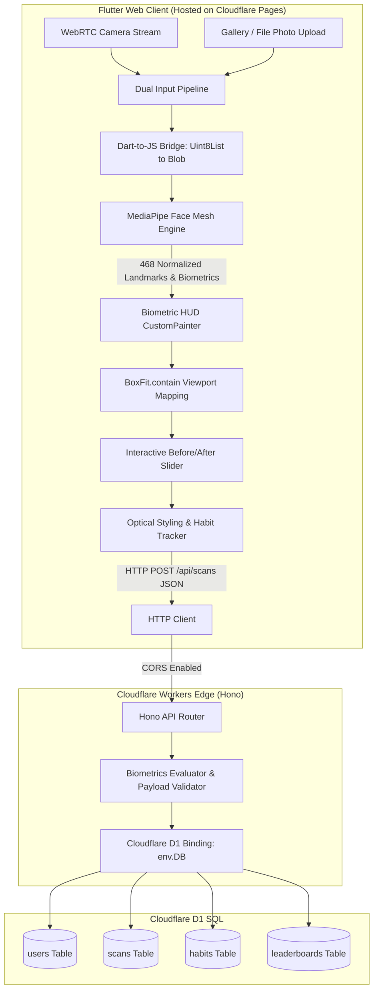

# Aesthetix: Golden Ratio Guide

> **Full-Stack Biometric Facial Proportion & Optical Styling Platform**

[](https://flutter.dev)
[](https://developers.google.com/mediapipe)
[](https://hono.dev)
[](https://developers.cloudflare.com/d1/)
[](https://pages.cloudflare.com/)
[](LICENSE)

---

## 1. Overview

**Aesthetix: Golden Ratio Guide** is an AI-inspired, scientifically grounded facial analysis and optical grooming platform. Built on the classical principles of the Golden Ratio ($\Phi \approx 1.618$) and bilateral symmetry, Aesthetix dynamically tracks 468 facial mesh landmarks in real time to evaluate facial vectors, gonial mandibular angles, canthal tilt, and symmetry axes. It recommends harmonizing haircuts, eyewear, and healthy daily wellness habits tailored to your unique anatomical proportions.

---

## 2. Architecture Overview



### Technical Stack Details

* **Client**: **Flutter (Dart) Web** featuring:
  * Dual-capture ingestion: Live HTML5 WebRTC camera (`html.VideoElement`) and gallery photo picker (`ImagePicker` up to 2560px).
  * Direct byte-to-canvas bridge passing raw `Uint8List` image buffers to JavaScript.
  * Real-time 468-point facial mesh tracking powered by client-side Google MediaPipe Face Mesh.
  * Aspect-ratio-aware `BiometricLandmarkPainter` mapping normalized $(0.0 \dots 1.0)$ coordinates across letterboxed / pillarboxed viewports with zero coordinate drift.
  * Interactive before/after golden potential slider (`_beforeAfterSliderPos`).
  * Cyberpunk dark-mode HUD aesthetic with laser sweep animations and glassmorphic controls.
* **Backend**: **Hono Framework** running on the **Cloudflare Workers** serverless edge runtime:
  * Global CORS middleware enabling communication with the Flutter web client.
  * Lightweight numerical metric persistence (gonial angles, canthal tilts, symmetry scores) without transferring heavy binary images to the worker.
* **Database**: **Cloudflare D1** serverless relational SQL database:
  * Low-latency regional SQLite edge storage tracking users, biometric scan records, habit adherence, and leaderboards.

---

## 3. Key Features & Engineering Innovations

### 1. Dual Capture Pipeline (Gallery Upload + WebRTC Stream)
* Supports both real-time desktop/laptop webcam streams via HTML5 `getUserMedia` and high-resolution photo uploads from device galleries (iPhone/Android/Desktop).
* Preserves high resolution (up to 2560px @ 98% quality) during image ingestion so fine facial features are clearly identifiable even in upper-body and distant portrait poses.

### 2. Client-Side FaceMesh & Safari WebAssembly Stabilization
* **Explicit WebAssembly CDN Resolver**: Configured explicit `locateFile` paths targeting `@mediapipe/face_mesh` CDN assets (`.wasm`, `.data`, and `.binarypb`), eliminating WebKit cross-origin redirect exceptions and initialization crashes on iOS Safari.
* **Non-Blocking Initialization**: Removed synchronous initialization traps, allowing lazy wasm runtime loading on the first frame pipeline execution.
* **CORS Safe Data Handling**: Eliminates `crossOrigin = 'anonymous'` on raw data URLs and in-memory blobs, preventing WebKit tainted canvas security exceptions.

### 3. High-Res Memory Guard & Async Byte Decoding
* **Native Blob & Object URL Bridge**: Converts raw Dart `Uint8List` byte buffers directly into image `Blob` instances and temporary Object URLs, bypassing base64 string transfer bottlenecks.
* **Asynchronous `img.decode()`**: Leverages browser-native off-thread image decoding before drawing to canvas.
* **1024px Downscaling Guard**: Automatically scales down massive 12MP+ mobile photos to a maximum dimension of 1024px onto an offscreen HTML Canvas before executing MediaPipe inference. This prevents iOS Safari WebAssembly memory allocation crashes and resolves false *"No face detected"* errors on passport and high-resolution photos.
* **Adaptive Confidence**: Calibrated `minDetectionConfidence: 0.3` and `minTrackingConfidence: 0.3` to reliably capture angled, distant, or partially turned faces.

### 4. Zero-Drift Viewport with `BoxFit.contain`
* **Viewport Containment**: Switched image rendering from `BoxFit.cover` to `BoxFit.contain`, preventing vertical and 9:16 mobile photos from having the head or chin cropped out.
* **Mathematical Aspect-Ratio Mapping**: `BiometricLandmarkPainter` computes the exact destination bounding box (`imageRect`) based on the true aspect ratio of the image:
  $$\text{imageRect} = \text{Rect.fromLTWH}(\text{offsetX}, \text{offsetY}, \text{renderWidth}, \text{renderHeight})$$
  Normalized coordinates $(x, y) \in [0, 1]$ map to screen coordinates via:
  $$X = \text{imageRect.left} + (x \times \text{imageRect.width}), \quad Y = \text{imageRect.top} + (y \times \text{imageRect.height})$$
  Ensures the landmark HUD aligns pixel-perfectly with real facial features regardless of viewport aspect ratio, letterboxing, or pillarboxing.

### 5. Dynamic Biometric HUD Calculations
* **Gonial Mandibular Angle**: Computes the exact 3D angle between the mandibular condyle (landmark 234/454), gonion angle (landmark 58/288), and chin apex (landmark 152).
* **Canthal Tilt Vector**: Measures the bilateral angle formed between the inner canthus (landmarks 133/362) and outer canthus (landmarks 33/263).
* **Bilateral Facial Symmetry**: Evaluates lateral distance ratios from facial landmarks to the vertical midline (forehead landmark 10 to menton landmark 175).
* **Dynamic Rating Derivations**: Rating breakdowns (`jawline`, `canthalTilt`, `symmetry`, `overallScore`) reflect genuine detected angles rather than randomized seed values.
* **Head Target Brackets**: Computes 468-point bounding boxes and renders cybernetic corner brackets framing the head location.
* **Interactive Layer Filters**: Toggle between `"All"`, `"Jawline"`, `"Canthal Tilt"`, `"Symmetry"`, and `"Clean (Off)"`.

### 6. Optical Grooming & Lifestyle Platform
* **Phenotype Classification**: Maps measurements to archetypes (*Balanced Oval*, *Square Diamond*, *Chiseled Oblong*, *Inverted Triangle*).
* **Styling Guidance**: Tailored haircut architectures (low tapers, French crops), eyewear frame geometry (panto, wayfarer, geometric), and beard contours.
* **Daily Proportional Wellness Tracker**: Micro-hydration (2.5L), SPF 50+ UV shielding, neutral cervical posture alignment, and sleep hygiene.

---

## 4. Quickstart & Local Setup Guide

### Prerequisites
* [Node.js](https://nodejs.org/) (v18+ recommended)
* [Flutter SDK](https://docs.flutter.dev/get-started/install) (v3.29+ recommended)
* Google Chrome or Safari browser

---

### Step 1: Start the Local Hono Backend (Cloudflare Workers + D1)

```bash
# Navigate to the backend directory
cd backend

# Install dependencies
npm install

# Run D1 database migrations locally (seeds schema.sql)
npm run db:migrate:local

# Start the Wrangler local dev server on http://127.0.0.1:8787
npm run dev
```

> **Note:** The backend server runs at `http://127.0.0.1:8787` with active CORS support.

---

### Step 2: Start the Flutter Frontend

```bash
# Navigate to the frontend directory
cd frontend

# Fetch Dart dependencies
flutter pub get

# Launch the app in your browser
flutter run -d chrome
```

---

### Step 3: Production Build & Deployment

To build the release bundle and deploy to Cloudflare Pages:

```bash
# From the frontend directory
flutter build web --release

# Deploy to Cloudflare Pages
npx wrangler pages deploy build/web --project-name aesthetix --branch main --commit-dirty=true
```

---

## 5. Database Schema (Cloudflare D1)

The backend schema defined in `backend/schema.sql` manages four relational tables:

```sql
-- 1. Users Profile & Streak Progression
CREATE TABLE IF NOT EXISTS users (
    id TEXT PRIMARY KEY,
    username TEXT NOT NULL,
    streak_days INTEGER DEFAULT 1,
    last_active_date TEXT,
    overall_rating REAL DEFAULT 0,
    potential_rating REAL DEFAULT 0,
    tier TEXT DEFAULT 'Harmonious Golden Ratio',
    created_at DATETIME DEFAULT CURRENT_TIMESTAMP
);

-- 2. Biometric Scan Records & Facial Angles
CREATE TABLE IF NOT EXISTS scans (
    id TEXT PRIMARY KEY,
    user_id TEXT NOT NULL,
    overall_score REAL NOT NULL,
    potential_score REAL NOT NULL,
    jawline_score REAL NOT NULL,
    cheekbones_score REAL NOT NULL,
    masculinity_score REAL NOT NULL,
    skin_quality_score REAL NOT NULL,
    canthal_tilt_score REAL NOT NULL,
    hair_score REAL NOT NULL,
    symmetry_score REAL NOT NULL,
    face_shape TEXT NOT NULL,
    archetype TEXT NOT NULL,
    strengths_json TEXT NOT NULL,
    flaws_json TEXT NOT NULL,
    recommendations_json TEXT NOT NULL,
    image_preview TEXT,
    created_at DATETIME DEFAULT CURRENT_TIMESTAMP,
    FOREIGN KEY(user_id) REFERENCES users(id)
);

-- 3. Daily Proportional Wellness Habits
CREATE TABLE IF NOT EXISTS habits (
    id TEXT PRIMARY KEY,
    user_id TEXT NOT NULL,
    title TEXT NOT NULL,
    category TEXT NOT NULL,
    completed INTEGER DEFAULT 0,
    created_at DATETIME DEFAULT CURRENT_TIMESTAMP,
    FOREIGN KEY(user_id) REFERENCES users(id)
);

-- 4. Aesthetic Proportions Community Leaderboard
CREATE TABLE IF NOT EXISTS leaderboards (
    id TEXT PRIMARY KEY,
    username TEXT NOT NULL,
    tier TEXT NOT NULL,
    overall_score REAL NOT NULL,
    potential_score REAL NOT NULL,
    avatar_index INTEGER DEFAULT 1,
    verified INTEGER DEFAULT 1
);
```

---

## 6. API Reference

| Method | Endpoint | Description |
| :--- | :--- | :--- |
| `GET` | `/` | Health check and worker runtime status |
| `POST` | `/api/user/init` | Create or sync user profile with default wellness habits |
| `POST` | `/api/scans` | Persist biometric scan metrics into Cloudflare D1 |
| `GET` | `/api/scans` | Retrieve scan history for the authenticated user |
| `GET` | `/api/habits` | Fetch daily wellness checklist |
| `PUT` | `/api/habits/:id` | Toggle habit completion status |
| `GET` | `/api/leaderboard` | View top global proportion scores |

---

## 7. License

This project is licensed under the MIT License — see the [LICENSE](LICENSE) file for details.
