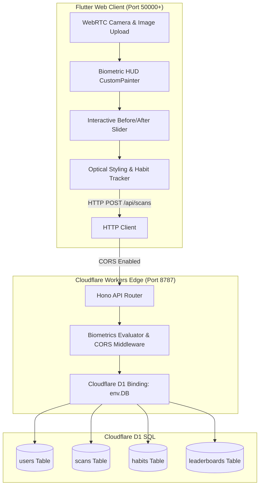

# Aesthetix: Golden Ratio Guide

> **Full-Stack Biometric Facial Proportion & Optical Styling Platform**

[](https://flutter.dev)
[](https://hono.dev)
[](https://developers.cloudflare.com/d1/)
[](LICENSE)

---

## 1. Overview

**Aesthetix: Golden Ratio Guide** is an AI-inspired, scientifically grounded facial analysis and optical grooming platform. Built on the classical principles of the Golden Ratio ($\Phi \approx 1.618$) and bilateral symmetry, Aesthetix evaluates facial vectors, gonial mandibular angles, and canthal tilt to recommend harmonizing haircuts, eyewear, and healthy daily wellness habits.

---

## 2. Architecture Overview



### Technical Stack Details

* **Client**: **Flutter (Dart) Web** featuring:
  * Hardware-accelerated WebRTC live camera preview (`html.VideoElement` via `dart:html` / `dart:ui_web`).
  * Custom mathematical landmark vector overlays rendered via `CustomPainter` (`Gonial Angle`, `Canthal Tilt`, `Symmetry Midline`).
  * Interactive Before/After golden potential slider (`_beforeAfterSliderPos`).
  * Cyberpunk dark-mode aesthetic with laser sweep animations and glassmorphic HUD controls.
* **Backend**: **Hono Framework** running on the **Cloudflare Workers** serverless edge runtime with:
  * Global CORS middleware (`app.use('/*', cors())`) enabling unrestricted communication with the Flutter web client.
  * Robust REST endpoints for user initialization, real-time look evaluations, and scan history.
* **Database**: **Cloudflare D1** serverless relational SQL database:
  * Low-latency regional SQLite edge storage.
  * Structured schema tracking users, biometric scan metrics, habit adherence, and community leaderboards.

---

## 3. Key Features

* **Live Hardware Webcam & File Upload Pipelines**
  * Direct access to laptop/desktop webcams using HTML5 `getUserMedia` and HTML Canvas frame grabbing.
  * Instant local portrait picker with high-resolution scaling and fallback preset profiles.
* **Biometric Geometric Vector Engine**
  * **Gonial Mandibular Angle**: Precise angular lines mapping ramus inclination to the gonion badge (e.g., $121.4^\circ$).
  * **Canthal Tilt Axis**: Bilateral vectors measuring palpebral fissure slant (e.g., $+4.6^\circ$ Positive Tilt).
  * **Bilateral Facial Symmetry**: Midline deviation scoring assessing hemifacial balance ($94.8\%$).
  * **Interactive Layer Filters**: Toggle between `"All"`, `"Jawline"`, `"Canthal Tilt"`, `"Symmetry"`, and `"Clean (Off)"`.
* **Optical Styling & Grooming Recommendation Engine**
  * Automatically classifies facial phenotypes into archetypes (*Balanced Oval*, *Square Diamond*, *Chiseled Oblong*, *Inverted Triangle*).
  * Generates actionable optical pairing guides:
    * **Haircut Architecture**: Low taper fades, French crops, or textured volume matched to forehead-to-jaw proportions.
    * **Eyewear Geometry**: Angular vs. rounded panto frames to balance cheekbone width.
    * **Beard Contouring**: Jawline shadowing to optimize the lower-third profile.
* **Daily Proportional Wellness Tracker**
  * Non-clinical lifestyle habits: Micro-hydration (2.5L), SPF 50+ UV shielding, neutral cervical posture alignment, and restorative sleep hygiene.
* **Store-Compliant Safety Disclaimer**
  * Clear educational and cosmetic labeling ensuring compliance with mobile and web application guidelines.

---

## 4. Quickstart & Local Setup Guide

### Prerequisites
* [Node.js](https://nodejs.org/) (v18+ recommended)
* [Flutter SDK](https://docs.flutter.dev/get-started/install) (Stable channel, Web-enabled)
* Google Chrome browser

---

### Step 1: Start the Local Hono Backend (Cloudflare Workers + D1)

Open a terminal in the project directory:

```bash
# Navigate to the backend directory
cd backend

# Install dependencies
npm install

# Run D1 database migrations locally (seeds schema.sql)
npm run db:migrate:local

# Start the Wrangler local dev server on http://127.0.0.1:8787
npm run dev
```

> **Note:** The backend server runs at `http://127.0.0.1:8787` with active CORS support.

---

### Step 2: Start the Flutter Frontend

Open a second terminal in the project directory:

```bash
# Navigate to the frontend directory
cd frontend

# Fetch Dart dependencies
flutter pub get

# Launch the app in Google Chrome
flutter run -d chrome
```

---

## 5. Database Schema (Cloudflare D1)

The backend schema defined in `backend/schema.sql` manages four relational tables:

```sql
-- 1. Users Profile & Streak Progression
CREATE TABLE IF NOT EXISTS users (
    id TEXT PRIMARY KEY,
    username TEXT NOT NULL,
    streak_days INTEGER DEFAULT 1,
    last_active_date TEXT,
    overall_rating REAL DEFAULT 0,
    potential_rating REAL DEFAULT 0,
    tier TEXT DEFAULT 'Harmonious Golden Ratio',
    created_at DATETIME DEFAULT CURRENT_TIMESTAMP
);

-- 2. Biometric Scan Records & Facial Angles
CREATE TABLE IF NOT EXISTS scans (
    id TEXT PRIMARY KEY,
    user_id TEXT NOT NULL,
    overall_score REAL NOT NULL,
    potential_score REAL NOT NULL,
    jawline_score REAL NOT NULL,
    cheekbones_score REAL NOT NULL,
    masculinity_score REAL NOT NULL,
    skin_quality_score REAL NOT NULL,
    canthal_tilt_score REAL NOT NULL,
    hair_score REAL NOT NULL,
    symmetry_score REAL NOT NULL,
    face_shape TEXT NOT NULL,
    archetype TEXT NOT NULL,
    strengths_json TEXT NOT NULL,
    flaws_json TEXT NOT NULL,
    recommendations_json TEXT NOT NULL,
    image_preview TEXT,
    created_at DATETIME DEFAULT CURRENT_TIMESTAMP,
    FOREIGN KEY(user_id) REFERENCES users(id)
);

-- 3. Daily Proportional Wellness Habits
CREATE TABLE IF NOT EXISTS habits (
    id TEXT PRIMARY KEY,
    user_id TEXT NOT NULL,
    title TEXT NOT NULL,
    category TEXT NOT NULL,
    completed INTEGER DEFAULT 0,
    created_at DATETIME DEFAULT CURRENT_TIMESTAMP,
    FOREIGN KEY(user_id) REFERENCES users(id)
);

-- 4. Aesthetic Proportions Community Leaderboard
CREATE TABLE IF NOT EXISTS leaderboards (
    id TEXT PRIMARY KEY,
    username TEXT NOT NULL,
    tier TEXT NOT NULL,
    overall_score REAL NOT NULL,
    potential_score REAL NOT NULL,
    avatar_index INTEGER DEFAULT 1,
    verified INTEGER DEFAULT 1
);
```

---

## 6. API Reference

| Method | Endpoint | Description |
| :--- | :--- | :--- |
| `GET` | `/` | Health check and worker runtime status |
| `POST` | `/api/user/init` | Create or sync user profile with default wellness habits |
| `POST` | `/api/scans` | Persist biometric scan metrics into Cloudflare D1 |
| `GET` | `/api/scans` | Retrieve scan history for the authenticated user |
| `GET` | `/api/habits` | Fetch daily wellness checklist |
| `PUT` | `/api/habits/:id` | Toggle habit completion status |
| `GET` | `/api/leaderboard` | View top global proportion scores |

---

## 7. License

This project is licensed under the MIT License — see the [LICENSE](LICENSE) file for details.
